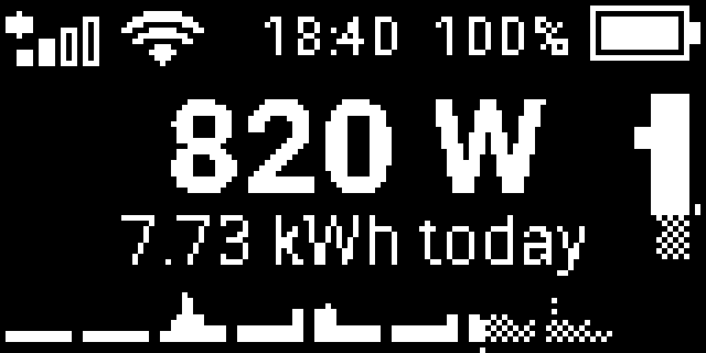

# esphome-wmbus-listener

This ESPHome firmware reads a smart electricity meter over radio. The board decrypts the meter's messages and sends live
power and energy values to Home Assistant over Wi-Fi.

It is built and tested on a **Heltec WiFi LoRa 32 V3** with a Linz Netz smart meter (NES 83335-3EEBMAA). The board only
listens to the radio messages the meter sends anyway, so nobody has to open the meter or touch its wiring.

- **Top row:** signal of your meter (4 bars; the dot in the top-left corner lights up for each of its messages, a hollow dot means only other meters in
  the last minute, an X means nothing at all), Wi-Fi (dotted arcs are missing strength, all dotted means no connection), time, battery.
- **Middle:** current power and the energy used today.
- **Bottom:** today in quarter-hour bars, from midnight on the left to the marker below the current bar. The dotted bars
  to the right of the marker are still yesterday.
- **Right column:** the current quarter hour, one bar per minute, from top to bottom. The dotted rows are the previous
  quarter hour.

## What you get

- **Live values every 5 seconds:** power import and export (kW), energy import and export (kWh).
- **Home Assistant integration:** the ESPHome integration discovers the board. The energy sensors work with the Energy
  dashboard. You do not need MQTT.
- **A small display:** current power, today's kWh, a quarter-hour chart of the day, a minute chart of the current
  quarter hour, Wi-Fi and battery status, and setup screens until the meter works.
- **No data leaves your network:** the board decrypts the messages itself.
- **Updates in Home Assistant:** boards from the web installer get new versions as a *Firmware* update.
- **Battery backup:** the board keeps running for about 19 hours when you unplug it.

## Does it work for you

It works if all of these are true:

- Your meter sends wireless M-Bus (wM-Bus) messages in **T1 mode on 868.95 MHz**, encrypted with AES-128.
- Your grid operator activates the meter's customer interface and gives you the AES key.
- You run Home Assistant with the ESPHome integration.

I tested the setup with one meter type: the NES 83335-3EEBMAA that Linz Netz installs. Other meters that the wmbusmeters
`amiplus` driver supports can work too, but I have not tested any.

## What you need

- **The board:** Heltec WiFi LoRa 32 V3, **868/915 MHz version**, with a LiPo battery. The tested set with battery and
  case cost €38. Without a battery, the low-battery cutoff can switch the board off. I have not tried a board without
  one.
- **A USB-A to USB-C data cable** for the first flash (many Heltec V3 boards do not work on USB-C to USB-C).
- **ESPHome 2026.11 or newer:** the Device Builder add-on in Home Assistant, or the ESPHome command line.
- **The AES key** for your meter from your grid operator.
- **Wi-Fi** within range of the board. Put the board within radio range of the meter.

## Quick start

**Fastest way:** open the [web installer](https://grinser.github.io/esphome-wmbus-listener/) in Chrome or Edge and
flash the prebuilt firmware. Then add the board in Home Assistant and enter the meter address and key on its device
page ([details](docs/web-installer.md)). **With an AI assistant:** give it
[docs/install-terminal.md](docs/install-terminal.md) and let it do the steps. To build the firmware yourself:

1. Activate the customer interface of your meter and get the AES key from your grid operator.
2. In the ESPHome Device Builder, add the keys from [`secrets.yaml.example`](secrets.yaml.example) to your secrets.
3. Create a new device, paste [`device-builder.yaml`](device-builder.yaml) and install it over USB.
4. Add the board in Home Assistant.
5. Find the radio address of your meter under *Meters nearby* and enter it with the key on the device page.

[docs/setup.md](docs/setup.md) explains every step, and the command-line path without the add-on.

## Documentation

- [Setup](docs/setup.md): key, installation, radio address, Home Assistant
- [Web installer](docs/web-installer.md): prebuilt firmware from the browser
- [Install from a terminal](docs/install-terminal.md): every step a command, also for AI assistants
- [Usage](docs/usage.md): settings, sensors, display and PRG button, battery
- [Troubleshooting](docs/troubleshooting.md)
- [Hardware and how it works](docs/hardware.md): data path, Heltec V3 pins
- [Recipes](recipes/): hot water, unmeasured load, meter reporting, Energy dashboard

## Limits

- **Tested with one meter type.** Nobody has tested other meters or other grid operators yet.
- **Home Assistant is necessary.** The board has no dashboard of its own.
- **Pins are for the Heltec V3.** Other boards need their own pin configuration.
- **Short messages only.** The SX1262 driver supports short wM-Bus frames. Electricity meter messages are short (about
  64 bytes).

## Roadmap

- **Standalone mode:** a dashboard on the board. You enter the key in the browser. Home Assistant is not necessary.
- **Other meters, and several on one board:** water, heat and gas meters also use wM-Bus.

## Development

`wmbus.yaml` includes the packages from this repository; `device-builder.yaml` loads the same packages from GitHub, with
the same settings. `tests/run.sh` runs host tests for the load chart, the night hours and the status bar, and checks
that both files carry the same settings. CI runs the tests and compiles the firmware with ESPHome 2026.11.0 on every push.

## Credits

- [SzczepanLeon/esphome-components](https://github.com/SzczepanLeon/esphome-components): the wM-Bus radio and meter
  components for ESPHome.
- [wmbusmeters](https://github.com/wmbusmeters/wmbusmeters): the meter drivers and the
  [online analyzer](https://wmbusmeters.org/analyze).

## License

GPL-3.0. See [LICENSE](LICENSE).
